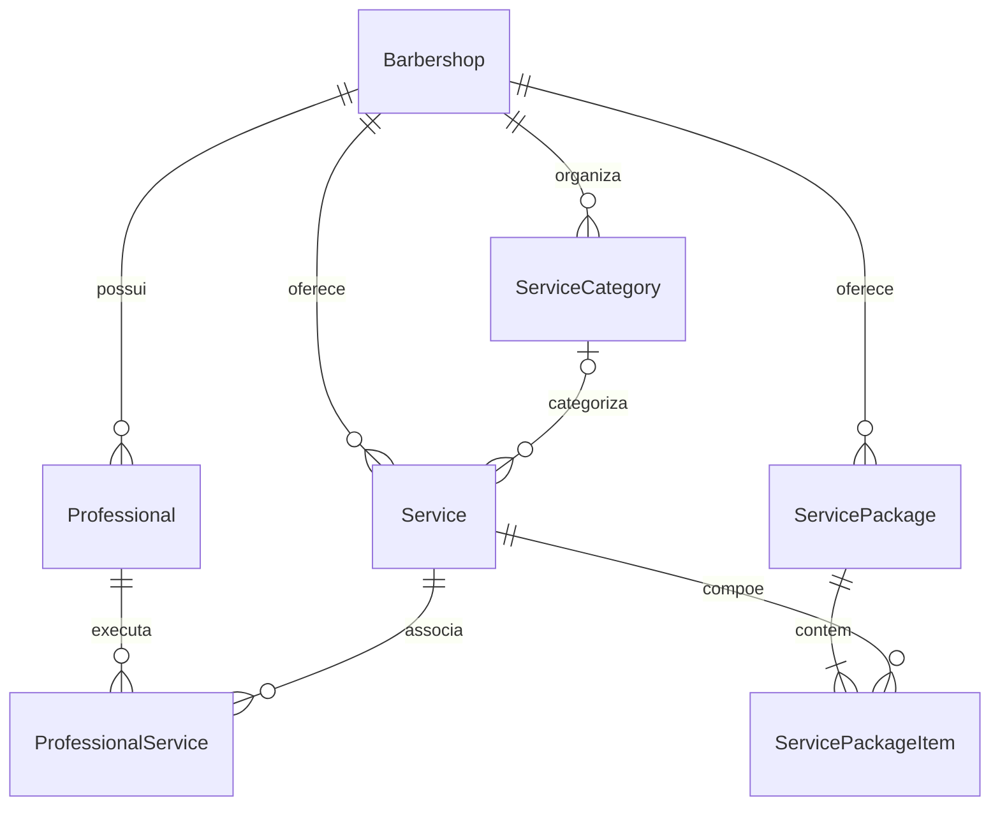

# Modelo de dados

Entidades principais incluem `ServicePackage` e `ServicePackageItem`. O item usa a chave `(barbershopId, packageId, serviceId)` e FKs compostas para impedir associações entre tenants. O preço promocional e a duração oficial são persistidos no pacote; preço original, totais individuais e economia são derivados dos serviços. A duração oficial é configurável e deve ser um inteiro positivo.

`ProfessionalService` usa chave composta `(barbershopId, professionalId, serviceId)`. As FKs compostas garantem que serviço e profissional pertençam ao tenant informado. Valores monetários são centavos inteiros.

Fonte canônica: `prisma/schema.prisma`.
